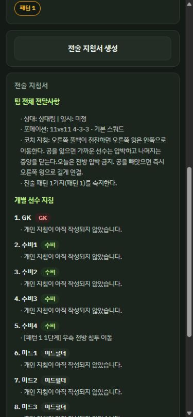
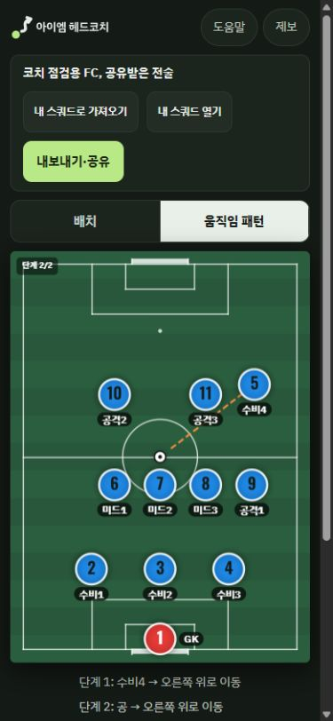
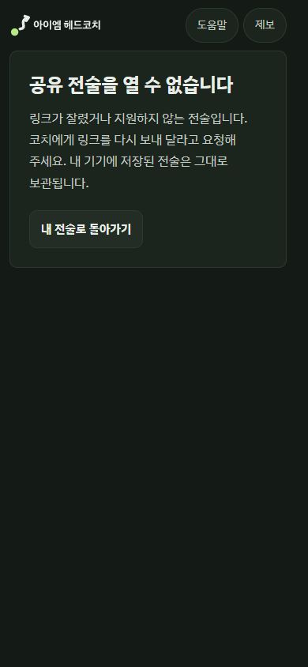

# 코치 사용성 수정 완료

2026-10-13 사용자 승인에 따라 감사에서 확인한 UX-001~006을 모두 수정했다. 작업 브랜치는 `feat/korean-branding-20261010`이다. 이후 사용자가 커밋·푸시·병합을 승인했으며 원격 통합 상태는 [PR #54](https://github.com/jaywapp/squad-maker/pull/54)에서 확인한다. 공개 배포본·CI·배포 설정은 변경하지 않았다.

## 변경 결과

| 이슈 | 수정한 동작 | 검증 |
|---|---|---|
| UX-001 | 팀·개인 지침과 경기 메모를 지침서·복사·텍스트 파일에 반영. 좌표 기반 문구는 접힌 자동 제안으로 분리 | 반대 전술 문구가 공식 전달문에 섞이지 않고 코치의 여러 줄 지침이 보존됨 |
| UX-002 | 패턴마다 출발 스쿼드와 선수 좌표를 고정·표시 | 배치·포메이션·화면 방향 전환, 저장·백업·공유 후 좌표 동일 |
| UX-003 | 손상·빈 값·잘못된 구조·미지원 버전 공유는 오류 화면 | 편집·저장·가져오기·내보내기 차단, 두 로컬 저장 원본 보존, 내 전술 복귀 확인 |
| UX-004 | 일시정지는 현재 프레임 유지, 이어 재생과 처음부터 재생 구분 | 이동 중·단계 대기 중 정지와 재개, 단계 이동 후 재생 정리 확인 |
| UX-005 | URL에 배치/패턴 모드·패턴 번호·단계 포함 | 수신자가 지정된 두 번째 패턴·두 번째 단계로 진입. 기존 링크와 범위 밖 값도 처리 |
| UX-006 | 공유 URL을 읽기 전용 입력란으로 표시 | 클립보드 거절·API 부재 시 URL만 선택하고 수동 복사 안내. 런타임 오류 없음 |

패턴 탭을 다시 열기만 할 때 불필요하게 자동저장을 예약하지 않도록 함께 정리했다. 기존 v1 fixture는 수정하지 않고, 호환성을 유지하는 추가 필드만 테스트 기대값에 명시했다.

## 검사 결과

- 단위 테스트: **161/161 통과** (`npm run test:unit`).
- 새 E2E: 14개 시나리오 × 데스크톱·모바일 = **28/28 통과**. 최종 코드에서도 아래 통합 재실행에 포함했다.
- 기존 관련 6개 spec: 최초 122개 중 115 통과·6 실패·1 생략. 실패는 구형 저장 기대값, 일시정지 문구, 불필요한 저장으로 인한 원본 비교에서 발생했다. 기대값과 저장 예약 동작 수정 후 해당 spec 3개 + 신규 spec을 다시 실행해 **82/82 통과**(58.8초).
- 중복을 제외한 최종 관련 브라우저 검사: **149 통과·1 생략**, 잔여 실패 없음. 생략은 기존 모바일 전체 GIF 검사이며 같은 기능은 데스크톱에서 통과했다. 프로젝트 전체 E2E 실행은 아니다.
- `npm run android:bundle`: 성공. 실제 Android APK 빌드·설치 검증은 아니다.
- 독립 코드 검토: `/root/coach_fixes_review`가 직렬화·복원·undo·GIF·RAF·오류 격리를 읽기 전용으로 검토. P1/P2 발견 없음.
- 직접 브라우저 확인: 기존 코치 점검용 11인제 전술로 지침서·정지/재개 UI, 390px 공유 수신·오류·복귀 확인. 정상 수신 화면 경고/오류 로그 없음.
- `git diff --check`: 통과.

검증은 기존 서버와 분리한 4397 포트를 사용했다. Chromium 실행에 sandbox 프로세스 제한이 있어 승인된 로컬 실행을 사용했다. CUA 수동 확인은 이전 감사에서 만든 같은 포트의 가상 팀 데이터만 사용했다.

재현 명령(전용 서버 실행 후):

```powershell
$env:PLAYWRIGHT_BROWSERS_PATH='C:\Users\jaywa\AppData\Local\ms-playwright'
node node_modules/@playwright/test/cli.js test --config=docs/coach-review-20261013/evidence/fix-playwright.config.cjs tests/e2e/coach-fixes-20261013.spec.js tests/e2e/local-library.spec.js tests/e2e/ui-contract.spec.js tests/e2e/launch-share-errors-20261010.spec.js tests/e2e/ux-fix-20261009.spec.js tests/e2e/ux-pattern-20261009.spec.js tests/e2e/guest-free-regression.spec.js
```

## 호환성과 남은 범위

기존 파일에는 패턴 작성 당시의 출발 위치가 없으므로 당시 저장된 선택 스쿼드 위치를 최초 출발점으로 삼는다. 이미 잃은 과거 출발점은 복구할 수 없다. 새 필드를 이해하지 못하는 이전 배포본은 이 고정을 보장하지 못한다.

공유는 선택한 단계의 시작점으로 열린다. 애니메이션의 중간 진행률·생성된 매치 전략 화면까지 동기화하지 않는다. 실기기·카카오톡 내부 브라우저 검증과 배포는 하지 않았다. 단계별 설명, 선수별 브리핑, 핵심 약속 정리는 원래 감사의 별도 제품 개선 제안으로 남겨 두었다.

## 수정 후 화면

코치 입력이 생성 지침서에 포함된다.



공유받은 사람이 지정된 두 번째 단계로 진입한다.



손상 링크는 기존 전술 편집기 대신 오류 안내를 표시한다.


