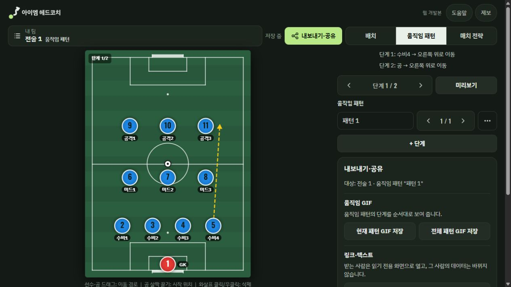
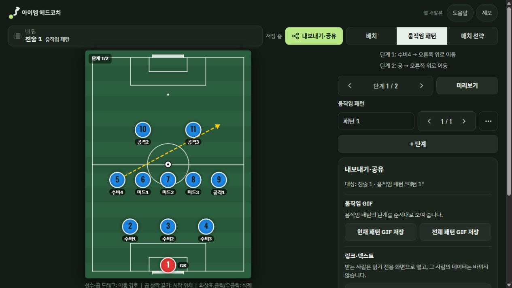

# 아이엠 헤드코치 조기축구 코치 관점 점검

> 후속 상태: 사용자 수정 승인 후 UX-001~006을 수정·재검증했다. 아래는 수정 전 감사 기록이며 현재 결과는 [수정 완료 보고](fixes.md)를 참고한다.

포메이션과 움직임을 만드는 기본기는 갖췄지만, 코치의 전술 의도를 팀원에게 정확하게 전달하려면 지침서·패턴 출발점·공유 오류 처리를 먼저 보완해야 한다. 현재 상태에서는 경기 전 설명 자료를 만들 수 있으나, 생성 지침서를 검토 없이 배포하거나 선수에게 링크만 보내고 이해를 기대하기는 어렵다.

## 점검 기준과 범위

- 기준일: 2026-10-13. 저장소 작업본 `feat/korean-branding-20261010`, HEAD `fd8798675681a2c77e83ec7fe0b94a7c6a7c23bf`.
- 경로: `D:\station\.worktrees\squad-maker-korean-branding-20261010`. 기본 `repos/squad-maker`의 main 및 공개 배포본과 구분한다.
- 역할: 조기축구 코치와 전술 링크를 받은 팀원. 11인제 4-3-3에서 오른쪽 풀백 전진, 공 연결, 공을 빼앗은 뒤의 행동을 설명하는 시나리오.
- 방법: 독립 검토 A(`/root/coach_review`, 소스 기반 코치 검토), B(`/root/technical_evidence`, 탐지기·격리 브라우저 검증)를 Codex가 통합했다. 주 세션은 실제 브라우저에서 입력·드래그·재생·공유 수신을 확인했다. A 완료 전 B 결과를 취합하지 않았다.
- 데스크톱 약 1264×712 및 390×844 화면을 직접 확인했다. B의 모바일 검증은 Chromium Pixel 5 에뮬레이션이며 실제 Android·카카오톡 검증은 아니다.
- 감사 전용이다. 운영 코드·설정·동작은 수정하지 않았고, 커밋·push·PR·배포는 수행하지 않았다.

## 우선 고칠 문제

| 우선순위 | 문제 | 코치와 선수에게 미치는 영향 | 권장 변경 |
|---|---|---|---|
| 높음 | 생성 지침서가 직접 작성한 팀·개인 지침을 누락 | ‘탈취 즉시 윙에게 길게 연결’이라고 적어도 ‘안전한 패스로 점유 유지’가 나와 서로 다른 약속을 전달 | 코치 입력을 우선 반영하고 자동 문장은 별도 제안으로 표시 |
| 높음 | 패턴 출발 위치가 현재 선택한 기본·공격·수비 배치에 종속 | 오른쪽 풀백의 전진 경로가 수비 배치를 본 뒤 왼쪽에서 출발하는 대각선 경로로 변함 | 패턴마다 출발 스쿼드·선수 위치를 저장하고 화면에 표시 |
| 높음 | 잘못된 공유 링크가 내 전술 편집기로 열림 | 팀원이 자기 기존 전술을 전달받은 전술로 오인할 수 있음 | 링크 오류 화면과 다시 받기 안내를 제공하고 편집기로 자동 전환하지 않음 |
| 보통 | ‘일시정지’가 현재 장면을 유지하지 않음 | ‘여기서 풀백을 보세요’라며 멈춘 순간에 화면이 단계 시작점으로 돌아감 | 정지 위치 유지·이어 재생·처음부터 재생을 분리 |
| 보통 | 패턴의 특정 단계를 공유해도 배치 화면으로 시작 | 선수가 코치가 설명하는 장면을 다시 찾아야 함 | 공유에 진입 화면·패턴·단계를 포함 |
| 보통 | 복사 권한 거절 후 링크 선택 복구 실패 | 복사 실패 안내대로 링크를 눌러도 선택되지 않고 오류 발생 | 읽기 전용 입력란과 명확한 선택·복사 대체 경로 제공 |

감사 시점에 확정 이슈는 6건(높음 3, 보통 3)이었다. 후속 작업에서 모두 수정했으며 재현 절차·당시 파일 위치·근거는 [이슈 목록](issues.md)에 있다.

## 코치로서 필요한 다음 개선

다음은 확인된 기능 범위를 바탕으로 한 제품 개선 제안이며, 고장으로 집계하지 않았다.

1. **단계마다 시작 신호와 설명을 붙인다.** 현재 요약은 ‘수비4 → 오른쪽 위로 이동’ 수준이다. ‘센터백이 공을 잡으면 → 윙이 안으로 좁히고 → 풀백이 바깥으로 전진한다’처럼 언제·왜 움직이는지 저장할 수 있어야 한다. `newStep()`에는 현재 이동과 공 경로만 있다(`index.html:2119`, `:3255`).
2. **팀원의 첫 행동을 ‘내 역할 보기’로 만든다.** 현재 모바일 수신 화면 상단은 ‘내 스쿼드로 가져오기’, ‘내 스쿼드 열기’, ‘내보내기·공유’가 차지한다. 선수 시점은 지침 아래에서 찾게 되고 패턴과 연결되지 않는다. 이름 선택 → 기본·공격·수비의 내 역할 → 관련 패턴 재생 순서가 조기축구 선수의 복습에 더 적합하다(`index.html:5061`).
3. **오늘 기억할 약속 세 가지를 앞세운다.** 단톡방 텍스트는 기본·공격·수비마다 같은 11명 명단을 반복한다. 경기 핵심 약속, 변경된 역할, 봐야 할 패턴을 먼저 전달하는 편이 설명 목적에 맞다(`index.html:4373`).
4. **배치 이미지와 브리핑 자료를 구분한다.** PNG에는 배치·선수·팀명은 있지만 팀·개인 지침은 없다. 현재 UI도 배치 그림으로 설명하므로 오류는 아니다. 지침 포함 이미지 또는 배치+지침+패턴 링크를 묶은 브리핑 출력이 있으면 단톡방 전달이 쉬워진다(`index.html:3139`).

개선 순서는 **내용 정확성 → 같은 장면 공유 → 멈춰서 설명 → 선수별 복습**이 적절하다. 새 기능을 늘리기 전에 작성한 내용이 전달 과정에서 달라지지 않도록 만드는 것이 우선이다.

## 유지할 장점

- 기본·공격·수비가 같은 선수 명단을 공유하고 상황별 위치·지침을 따로 가지므로 실명을 유지한 역할 설명이 가능하다.
- 선수 시점에서 세 상황의 자기 위치와 팀·개인 지침을 모아 볼 수 있다. 이 기능을 수신 흐름 전면으로 옮길 가치가 크다.
- 공과 선수 이동을 여러 단계로 만들고 GIF로 내보낼 수 있어 원투패스·오버래핑 설명의 기초가 있다.
- 정상 공유 링크는 비회원 읽기 전용으로 열리고, 기존 원본을 보호한다. 기기 저장 상태와 편집 가능한 `.sq` 백업의 구분도 명확하다.

## 검증 결과와 한계

- 선정한 기존 모바일 테스트 **6/6 통과**, 실행 23.3초. PNG 회전 출력, 단일·전체 GIF, 읽기 전용 공유와 양쪽 원본 보호, 작은 세로 화면의 5~11인, 링크 인코딩 실패의 데이터 보존을 확인했다. 전체 테스트 통과를 의미하지 않는다.
- 추가 격리 브라우저에서 지침서 누락·반대 지시, 공유 시작 화면 차이, 손상 링크, 복사 권한 거절을 재현했다. 주 세션은 지침서·패턴 출발점·정지 화면·정상 및 손상 링크를 직접 확인했다.
- 모바일 정상·손상 링크의 가로 넘침은 없었다. 주 세션의 정상 수신 탭에서 경고·오류 로그는 없었다. 복사 실패 조건에서는 `this.select is not a function`을 별도 재현했다.
- 결정론적 탐지기는 `index.html`에 1회 실행했다. 경고 1건은 준비 중 상태의 왼쪽 강조선(`:350`)으로, 기능 목적이 있는 스타일이라 코치 사용성 문제에서 제외했다. 탐지 결과 0건이 접근성·성능 전체 통과를 의미하지 않는다.
- 실제 스마트폰 터치·가상 키보드·카카오톡 안의 브라우저·APK·현재 공개 배포본은 검증하지 않았다. 실명 명단이나 실제 팀 메시지를 전송하지 않았다.
- 재현 코드, JSON 결과, 화면은 [evidence](evidence/)에 보관했다. 탐지 target slug는 `index-html`, ignore 파일은 없었다. A/B에서 CUA가 제공되지 않아 B는 Playwright로 대체했고 주 세션은 CUA를 사용했다. 브라우저 내 탐지 overlay는 만들지 않았다.
- 이 점검 전용 4397 서버와 임시 브라우저 탭은 점검 종료 때 정리했다. 기존 4317·4318·4319 서버에는 손대지 않았다.

## 화면 근거

같은 패턴이 기본 배치와 수비 배치에 따라 다르게 표시된다.

추가 근거: [생성 지침서](evidence/strategy-coach-note-omission-390.png), [공유 시작 화면](evidence/pattern-recipient-390.png), [손상 링크의 편집기 진입](evidence/broken-share-recipient-390.png), [재현 측정값](evidence/mobile-probes.json), [기존 테스트 결과](evidence/playwright-results.json).
